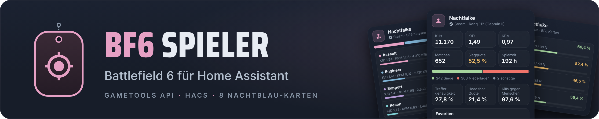
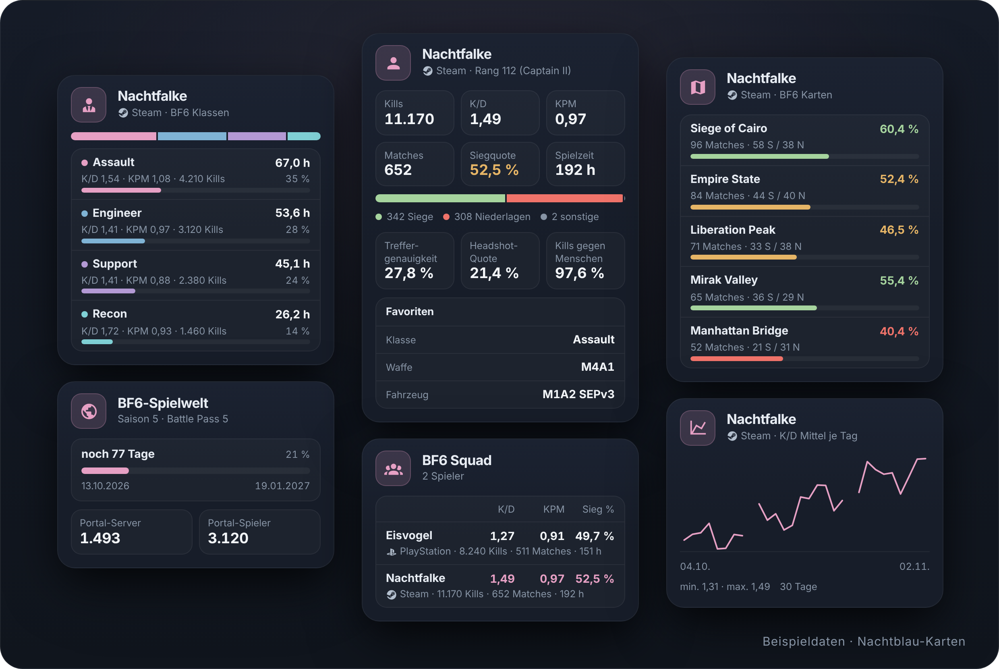

<p align="center">
  
</p>

# BF6 Spieler

[](https://claude.com/claude-code)
[](#ki-hinweis)

Home-Assistant-Integration für Spielerstatistiken aus Battlefield 6: K/D,
Winrate, Waffen, Fahrzeuge, Klassen, Karten, Modi und Rang als Sensoren, dazu
Saison und Portal-Server. Die Daten kommen aus der Community-API
[api.gametools.network](https://api.gametools.network/docs), nicht von EA.
Version 0.6.4.

> **Stand:** Version 0.6.4: Jeder Spieler ist ein Gerät mit 20 Sensoren,
> Rang-Abzeichen und den Ereignissen „Match beendet“ und „Rang gestiegen“
> (siehe [Entitäten je Spieler](#entitäten-je-spieler)); dazu das Gerät
> „BF6-Spielwelt“, Aktionen, Optionen, Diagnose, Reparaturhinweis und acht
> [Dashboard-Karten](#dashboard-karten) im Nachtblau-Stil. Den Plan zeigt
> die Recherche in [`docs/bf6-api-recherche.html`](docs/bf6-api-recherche.html).

<p align="center">
  
</p>
<p align="center"><sub>Klassen, Spielwelt, Spieler, Squad, Karten und Verlauf · Beispieldaten</sub></p>

> **KI-Hinweis:** Dieses Projekt entsteht mit Claude Code. Code, Tests und
> Dokumentation schreibt die KI; Details im Abschnitt [KI-Hinweis](#ki-hinweis).

Aufbau, Prüfungen und Karten folgen der Integration
[WoW Charakter](https://github.com/philf90/HA-WOW), Farben und Bausteine der
Karten dem Nachtblau-Stil aus
[philf90/home-assistant](https://github.com/philf90/home-assistant)
(`DESIGN.md`, `design/palette.yaml`).

## Voraussetzungen

- **Home Assistant 2026.2.3 oder neuer**
- **[HACS](https://hacs.xyz)** für die Installation per Klick (ohne HACS geht es
  auch, siehe unten)
- Kein API-Schlüssel: Die gametools API ist ohne Anmeldung erreichbar.

## Installation

[](https://my.home-assistant.io/redirect/hacs_repository/?owner=philf90&repository=HA-BF6&category=integration)
[](https://my.home-assistant.io/redirect/config_flow_start/?domain=bf6_player)

1. **Integration herunterladen:** Erste Schaltfläche oben → HACS fragt, ob das
   Repository hinzugefügt werden soll → **Hinzufügen** → **Herunterladen**.
   Von Hand: HACS → ⋮ → **Benutzerdefinierte Repositories** →
   `https://github.com/philf90/HA-BF6`, Typ „Integration“ → „BF6 Spieler“
   herunterladen.
   Ohne HACS: Ordner `custom_components/bf6_player` nach
   `config/custom_components/` kopieren.
2. **Home Assistant neu starten.**
3. **Einrichten:** Zweite Schaltfläche oben, oder Einstellungen → Geräte & Dienste
   → Integration hinzufügen → „BF6 Spieler“ → **Absenden**. Es entsteht der
   Eintrag „gametools API“; einen zweiten lehnt der Dialog ab.
4. **Spieler hinzufügen** (seit 0.3.0): Einstellungen → Geräte & Dienste →
   BF6 Spieler → beim Eintrag „gametools API“ **Spieler hinzufügen**.
   Spielernamen eingeben, so wie er in Battlefield 6 steht (EA-Name, Steam-,
   PlayStation- oder Xbox-Name), höchstens 64 Zeichen; Sonderzeichen sind
   erlaubt (siehe [Sicherheit](#sicherheit)). Die Liste zeigt alle Konten mit diesem Namen,
   die noch nicht eingerichtet sind, je Zeile Name, Plattform und das Datum, an
   dem das Konto angelegt wurde; 🔒 kennzeichnet ein nicht öffentliches Konto.
   Das richtige Konto wählen. Vor dem Anlegen fragt die Integration die
   Statistik ab; kennt die API zu dem Konto keine BF6-Werte, meldet der Dialog
   das und legt nichts an. Gespeichert werden Persona-ID, Nucleus-ID und
   Plattform, nicht der Name: Namen sind nicht eindeutig (am 01.11.2026 zwei
   Steam-Konten mit demselben Namen und völlig anderen Werten). In der Liste
   heißt der Spieler „Name · Plattform“, z. B. „Testspieler · Steam“ (seit
   0.3.1); ein eigenes Symbol je Spieler zeigt Home Assistant dort nicht an.

## Datenquelle

Battlefield 6 hat keine offizielle, öffentlich dokumentierte Stats-API von EA.
Die Integration nutzt deshalb die Community-API von
[Community Network](https://github.com/community-network) (OpenAPI 1.3.0 unter
<https://api.gametools.network/openapi.json>). Sie braucht keinen Schlüssel,
cacht Antworten 600 Sekunden und nennt kein Abfragelimit. Laut ihrer
Beschreibung stammen die Daten aus den Systemen von EA/DICE. Die Integration
ist kein Produkt von EA, DICE oder Community Network. Fragen zur API:
[Discord von Community Network](https://discord.gg/zMuxW6c); unterstützen:
[GitHub Sponsors](https://github.com/sponsors/community-network).

## Aufbau

- **Haupteintrag „gametools API“** (seit 0.1.0): einmalig, ohne Zugangsdaten.
  Seit 0.5.0 mit Optionen für die Takte; abschaltbare Gruppen gibt es nicht
  (siehe [Optionen, Aktionen, Diagnose](#optionen-aktionen-diagnose)).
- **Untereintrag je Spieler** (seit 0.3.0): Name suchen, Konto aus der
  Trefferliste wählen. Gespeichert werden Persona-ID, Nucleus-ID und Plattform,
  weil Namen nicht eindeutig sind. Jeder Spieler ist ein eigenes Gerät
  (seit 0.4.0, Hersteller „Electronic Arts“, Modell „Battlefield 6 ·
  Plattform“) mit eigener Abfrage. Fällt die Abfrage eines Spielers aus,
  sind nur seine Entitäten nicht verfügbar. Ein neuer oder gelöschter
  Spieler lädt den Eintrag neu, Umbenennen nicht.
- **Plattform-Symbole** (seit 0.4.0): Home Assistant bringt MDI 7.4.47 mit;
  daraus `mdi:steam`, `mdi:sony-playstation`, `mdi:microsoft-xbox` und
  `mdi:microsoft-windows`. Für EA app und Epic Games gibt es dort kein
  Symbol; sie bekommen den Controller `mdi:gamepad-variant`.
- **Gerät „BF6-Spielwelt“** (seit 0.5.0): Saison, Battle Pass und Portal-Server.
- **Dashboard-Karten** (seit 0.6.0): von der Integration ausgeliefert, ohne
  eigene Dashboard-Ressource (siehe [Dashboard-Karten](#dashboard-karten)).

## Entitäten je Spieler

Seit 0.4.0. Zähler als `total_increasing`, Quoten als `measurement`: Home
Assistant führt für beide Langzeitstatistiken, daraus entstehen Verläufe ab
der Installation.

| Wert | Typ | Takt | Quelle (Endpunkt, Feld) |
|---|---|---|---|
| Kills, Tode, Assists, Wiederbelebungen | Sensoren, Zähler | 15 min | `/bf6/stats/`, `kills`, `deaths`, `assists`, `revives` |
| Matches, Siege, Niederlagen (an „Matches“ seit 0.6.0 die Attribute `maps` und `modes`) | Sensoren, Zähler | 15 min | `matchesPlayed`, `wins`, `loses`; Listen aus `maps[]` und `gameModes[]` |
| XP | Sensor, Zähler | 15 min | `XP[0].total` |
| Spielzeit | Sensor, Dauer in Stunden | 15 min | `secondsPlayed` |
| K/D, Kills pro Minute | Sensoren | 15 min | selbst gerechnet: Kills ÷ Tode, Kills ÷ Spielminuten |
| Siegquote, Treffergenauigkeit, Headshot-Quote, Kills gegen Menschen | Sensoren in % | 15 min | selbst gerechnet: Siege ÷ Matches, Treffer ÷ Schüsse, Headshots ÷ Kills, `dividedKills.human` ÷ Kills |
| Rang (Rangname, Dog Tags, Abzeichen, Rang-Bild, Ranked-Rang als Attribute) | Sensor | 60 min | `/bf6/profile/`, `playerCard.rank`, `rankName`, `totalDogTags`, `badgeSummary.totalBadges`, `playerCard.rankImage.large`, `competitiveRanks` |
| Meistgespielte Klasse (seit 0.6.0 alle Klassen als Attribut `classes`) | Sensor (Text) | 15 min | `classes[]` mit der längsten Spielzeit |
| Top-Waffe, Top-Fahrzeug (Top 5 als Attribut `top`) | Sensoren (Text) | 15 min | `weapons[]`, `vehicles[]` nach Kills |
| Plattform | Sensor (Diagnose), Symbol je Plattform | gespeichert | aus dem Dialog „Spieler hinzufügen“ |
| Rang-Abzeichen | Bild (seit 0.5.0) | 60 min | `/bf6/profile/`, `playerCard.rankImage.large` |
| Match beendet | Ereignis (seit 0.5.0) | 15 min | Zuwachs von `matchesPlayed` und der Zähler zwischen zwei Abfragen |
| Rang gestiegen | Ereignis (seit 0.5.0) | 60 min | Zuwachs von `playerCard.rank` |

- **Takt:** Statistik alle 15 Minuten; die API cacht Antworten 600 s, öfter
  bringt keine neueren Werte. Profil stündlich; scheitert es, bleibt der
  letzte Stand und die Statistik läuft weiter. Höchstens zwei Spieler
  werden gleichzeitig abgefragt.
- **Nicht verfügbar** sind die Entitäten eines Spielers, wenn die API nicht
  antwortet oder zu seinem Konto keine Statistik liefert (`hasResults:
  false`). Die Plattform bleibt sichtbar.
- **Entity-IDs** entstehen aus dem Spielernamen und dem Namen des Sensors in
  der Sprache der Oberfläche, z. B. `sensor.testspieler_kills`.

### Ereignisse (seit 0.5.0)

Die API kennt keine einzelnen Matches. „Match beendet“ entsteht, wenn
`matchesPlayed` zwischen zwei Abfragen wächst, und meldet die Zuwächse:
`matches`, `wins`, `losses`, `kills`, `deaths`, `assists`, `revives`, `xp`,
`seconds_played`, dazu `kd` (Kills ÷ Tode der neuen Matches) und `result`
(`win` oder `loss`, nur bei genau einem neuen Match, sonst leer). Liegen
mehrere Matches zwischen zwei Abfragen, kommt ein Ereignis über alle. „Rang
gestiegen“ meldet `previous_rank`, `rank` und `rank_name`.

- Die erste Abfrage nach dem Start setzt nur den Ausgangsstand: Matches
  während eines Neustarts oder Neuladens lösen kein Ereignis aus.
- Sinkt ein Zähler (Korrektur der API), gibt es kein Ereignis.
- Scheitert eine Abfrage, wiederholt sich kein Ereignis.
- Ein Ereignis kommt frühestens mit der nächsten Abfrage nach dem Match,
  bei 15 Minuten Takt und 10 Minuten Cache der API also mit Verzögerung.

### Nicht in der Datenbank

Diese Attribute stehen am Sensor, gehen aber nicht in den Verlauf (Listen und
Adressen, 16-KB-Grenze des Recorders): `top` (Top-Waffe, Top-Fahrzeug),
`ranked` und `rank_image` (Rang), `maps` und `modes` (Matches) sowie
`classes` (Meistgespielte Klasse).

Die Listen `maps`, `modes` und `classes` sind für die Karten da (seit 0.6.0).
Einträge von `maps`: `name`, `aliases`, `matches`, `wins`, `losses`,
`win_rate`, `seconds`; von `modes`: `name`, `aliases`, `matches`, `wins`,
`losses`, `win_rate`, `kills`, `kd`; von `classes`: `name`, `kills`,
`deaths`, `kd`, `kpm`, `seconds`.

## Gerät „BF6-Spielwelt“

Seit 0.5.0, eines je Eintrag, auch ohne Spieler.

| Wert | Typ | Takt | Quelle (Endpunkt, Feld) |
|---|---|---|---|
| Saisonende (Saison, Saisonbeginn, Battle Pass als Attribute) | Zeitstempel | 6 h | `/bf6/gameevents/`, aktives Ereignis `Season<n>`, `validUntil.end.value`; Battle Pass aus `BP<n>` |
| Portal-Server, Portal-Spieler | Sensoren | 15 min | `/bf6/status/`, `regions.ALL.amounts.serverAmount`, `soldierAmount` |

Die Zahlen zählen nur Portal-Server, nicht die offiziellen Playlists (laut
Beschreibung des Endpunkts). Scheitert eine der beiden Abfragen, bleibt ihr
letzter Stand; nicht verfügbar wird die Spielwelt erst, wenn beide nichts
liefern.

## Optionen, Aktionen, Diagnose

- **Optionen** (seit 0.5.0, „Konfigurieren“ am Eintrag „gametools API“):
  Takt der Statistik 10–120 min (Vorgabe 15) und des Profils 15–720 min
  (Vorgabe 60); das Profil darf nicht öfter laufen als die Statistik.
  Speichern lädt den Eintrag neu. Abschaltbare Gruppen wie bei WoW Charakter
  gibt es nicht: Alle Spielerwerte kommen aus einer Abfrage, eine Gruppe
  spart nichts; einzelne Entitäten lassen sich in Home Assistant
  deaktivieren.
- **`bf6_player.refresh`**: Spieler und Spielwelt sofort abfragen, wahlweise
  nur bestimmte Geräte. Die API cacht Antworten 10 Minuten.
- **`bf6_player.get_player`**: Konten zu einem Namen nachschlagen (Name,
  IDs, Plattform, Erstellungsdatum, öffentlich), ohne etwas anzulegen; nur
  mit Antwort. Gleiche Namensprüfung wie im Dialog.
- **Reparaturhinweis**, wenn die API für einen Spieler keine Statistik
  liefert (`hasResults: false`); er verschwindet mit der nächsten
  erfolgreichen Abfrage oder mit dem Löschen des Spielers.
- **Diagnose** (Gerät bzw. Eintrag → Diagnose herunterladen): Zustand und
  Daten der Abfragen; Name und Titel des Spielers, Persona- und Nucleus-ID
  geschwärzt. Namen von Waffen, Fahrzeugen, Klassen, Karten und Modi
  bleiben lesbar (seit 0.5.1; in 0.5.0 ebenfalls geschwärzt).

## Dashboard-Karten

Seit 0.6.0. Die Integration liefert die Karten selbst aus und meldet sie im
Frontend an, wie WoW Charakter: Eine Dashboard-Ressource ist nicht nötig.
Nach einem Update lädt der Browser die neue Version, weil sie im Pfad steht
(`/bf6_player/<karte>.js?v=<Version>`). Ein Neustart von Home Assistant
allein reicht dafür nicht: Die geöffnete Seite behält die schon geladenen
Karten, bis sie neu geladen wird (Browser: Strg+F5; Companion-App:
„Frontend-Cache zurücksetzen“). Live gesehen am 02.11.2026 mit 0.6.2. Im
Kartenwähler stehen sie unter „Benutzerdefiniert“ als „BF6 …“.

| Karte | Typ | Inhalt | Optionen |
|---|---|---|---|
| BF6 Spieler | `custom:bf6-player-card` | Rang-Abzeichen, Name, Plattform mit Symbol, Rang; Kills, K/D, KPM, Matches, Siegquote, Spielzeit; Balken Siege/Niederlagen/sonstige; Treffergenauigkeit, Headshot-Quote, Kills gegen Menschen; Klasse, Waffe, Fahrzeug | `entity` |
| BF6 Arsenal | `custom:bf6-arsenal-card` | Top-Waffen mit Bild, Kills, Genauigkeit, Headshot-Quote, KPM; Top-Fahrzeuge mit Kills und Zeit | `entity`, `limit` (1–5), `show` (`weapons`, `vehicles`) |
| BF6 Klassen | `custom:bf6-classes-card` | Anteil der Klassen an der Spielzeit, je Klasse Stunden, K/D, KPM, Kills | `entity` |
| BF6 Karten | `custom:bf6-maps-card` | Siegquote je Karte mit Siegen, Niederlagen, Matches und zweitem Namen | `entity`, `min_matches` (Vorgabe 1), `limit` (Vorgabe 10), `sort` (`matches` oder `win_rate`) |
| BF6 Modi | `custom:bf6-modes-card` | Matches je Modus, Siegquote, K/D, Kills | `entity`, `limit` (Vorgabe 8) |
| BF6 Squad | `custom:bf6-squad-card` | mehrere Spieler: K/D, KPM, Siegquote, darunter Kills, Matches, Spielzeit; der beste Wert je Spalte in Rosé | `entities` (leer: alle Spieler), `title` |
| BF6 Spielwelt | `custom:bf6-world-card` | Saison und Battle Pass, Restzeit, vergangener Anteil, Beginn und Ende; Portal-Server und -Spieler | – |
| BF6 Verlauf | `custom:bf6-history-card` | Langzeitstatistik eines Werts: Quoten als Linie des Mittelwerts, Zähler als Balken des Zuwachses je Zeitraum | `entity`, `metric` (`kd`, `kpm`, `win_rate`, `accuracy`, `headshot_rate`, `rank`, `kills`, `matches`, `wins`, `xp`, `time_played`), `period` (`day`, `week`, `month`), `days` (7–365, Vorgabe 30) |

```yaml
type: custom:bf6-maps-card
entity: sensor.testspieler_kills   # beliebige Entität des Spielers; leer: erster Spieler
min_matches: 3
sort: win_rate
```

- **Editor:** Statt aller Sensoren bietet er nur die Spieler an („Name ·
  Plattform“) und speichert deren Kills-Sensor; die Karten finden die
  übrigen Entitäten über das Gerät. Ohne Angabe zeigt eine Karte den
  ersten Spieler nach Namen.
- **Stil:** Nachtblau aus `philf90/home-assistant` (Hülle mit Verlauf,
  Radius 22 px, Unterkacheln, Akzent Rosé). Jede Farbe ist eine
  Theme-Variable (`--nachtblau-…`) mit dem dunklen Palettenwert als
  Rückfall. Breite geprüft bei 344 und 386 px.
- **Heller Modus:** Mit dem Theme „nachtblau“ folgen die Karten dem Modus,
  den jeder Benutzer im Profil wählt (System, Hell, Dunkel); ohne das Theme
  sind sie in beiden Modi dunkel. Hell gelten die Tieftöne der Palette
  (z. B. Rosé `#994776`, Grün `#38702e`, Amber `#855c04`, Rot `#ae3c38`)
  auf der Hülle `#fafbfd` → `#f3f5f8`. Kleinster Textkontrast hell, auf
  der Unterkachel `#eceff2` gerechnet: Sekundärtext 5,21:1, Akzente
  5,13–5,19:1 (WCAG 2.x, wie DESIGN.md). Die Waffen-, Fahrzeug- und
  Rangbilder vom CDN sind überwiegend dunkel und stehen auf heller Hülle
  besser als auf dunkler (gemessen an 7 Bildern vom 02.11.2026: unter
  1,5:1 zum Grund hell 0–4 %, dunkel 25–83 % der deckenden Bildpunkte).
- **Lichtrand** (seit 0.6.4): Im dunklen Modus bekommen Waffen- und
  Fahrzeugbilder einen feinen hellen Rand (`drop-shadow` in der Farbe des
  Primärtexts mit 90 % und 50 % Deckkraft), damit sich die Umrisse von der
  Hülle abheben; das Bild selbst bleibt unverändert. Gegen den Rand liegen
  0–5 % der Bildpunkte unter 1,5:1 (ohne Rand gegen die Hülle 22–86 %).
  Im hellen Modus schaltet `nachtblau-dunkel-anteil` den Rand durchsichtig.
  Das Rang-Abzeichen im Kopf bleibt ohne Rand. DESIGN.md kennt diese Form
  nicht; sie ist eine Ausnahme dieser Karten, gewählt aus vier gerenderten
  Varianten (ohne, Bildkachel in Label-Grau, Bildkachel in Wolkengrau,
  Lichtrand).
- **Siegquote** in Farbe: ab 55 % grün, ab 45 % amber, darunter rot; die
  Zahl steht immer daneben.
- **Summen:** Die Karten nehmen die Gesamtwerte der Sensoren und rechnen sie
  nicht aus den Listen nach; die API zählt dort unterschiedlich (live am
  02.11.2026: 747 Matches oben, 787 in der Moduszeile „All“, 714 in der
  Kartenzeile „All“). „sonstige“ im Balken der Spielerkarte sind Matches
  minus Siege minus Niederlagen (am selben Tag: 1).
- **Verlauf:** liest `recorder/statistics_during_period`; Home Assistant
  bildet die Langzeitstatistik stündlich, die ersten Werte erscheinen also
  einige Stunden nach der Installation. Seit 0.6.2 hat jeder Tag (bzw.
  jede Woche, jeder Monat) einen festen Platz, heute rechts; Tage ohne Werte
  bleiben leer. Werte stehen beim Überfahren mit der
  Maus an den Balken bzw. Punkten, Summe bzw. kleinster und größter Wert als
  Text darunter.

## Abfragen und Auswertung

Seit 0.2.0 (`api.py`, `parsers.py`), noch ohne Entitäten. Abgefragt wird immer
per ID, nie per Name:

| Endpunkt | Parameter | Auswertung |
|---|---|---|
| `/bf6/player/` | `name`, `limit` | Konten mit Persona-ID, Nucleus-ID, Plattform, Name, Erstellungsdatum, öffentlich ja/nein |
| `/bf6/stats/` | `playerid`, `nucleus_id`, `platform`, `format_values=false`, `seperation` | Kennzahlen, Top 5 Waffen, Fahrzeuge und Gadgets, Klassen, Karten, Modi |
| `/bf6/profile/` | `playerid`, `nucleus_id`, `platform` | Rang, Rangname, Rang-Bild, Dog Tags, Abzeichen, Ranked-Rang |
| `/bf6/gameevents/` | – | Laufende Saison mit Start und Ende, Battle Pass |
| `/bf6/status/` | – | Server, Spieler und Warteschlange der Portal-Server |

- **Selbst gerechnet** aus den Zählern: K/D (Kills ÷ Deaths), KPM (Kills ÷
  Spielminuten), Winrate (Siege ÷ Matches), Accuracy (Treffer ÷ Schüsse),
  Headshot-Quote (Headshots ÷ Kills) und Anteil der Kills gegen Menschen. Die
  API rechnet mit unterschiedlichen Zeitbasen (KPM 1,55 oben, 1,96 bei den
  Klassen desselben Kontos). Gegen echte Antworten vom 01.11.2026 geprüft:
  alle sechs Werte gleich den Werten der API.
- **Unbekannte IDs** liefern HTTP 200 mit `hasResults: false` und lauter
  Nullen, keinen Fehler. Daraus wird `has_results`.
- **Abzeichen:** Das Profil nennt zwei Zahlen, `badgeSummary.totalBadges`
  und `playerCard.badges`. Die Integration nutzt `totalBadges`; das ist die
  Zahl, die das Spiel anzeigt (Abgleich am 02.11.2026: Spiel 48,
  `totalBadges` 48, `playerCard.badges` 120). Was `playerCard.badges`
  zählt, ist nicht belegt.
- **Daten je EA-Konto:** `/bf6/stats/` liefert die Werte zur `nucleus_id`
  (EA-Konto); `playerid` wird nur zurückgegeben. Geprüft am 02.11.2026 mit
  zwei öffentlichen Konten: vertauschte `playerid` bei gleicher
  `nucleus_id` ergab dieselben Werte (25 Matches), die andere
  `nucleus_id` andere (207 Matches). Dasselbe EA-Konto zweimal
  eingerichtet, etwa über zwei Plattformen, ergäbe zwei Geräte mit
  gleichen Werten.
- **Sammelabfrage `/bf6/multiple/`** (bis 128 Spieler je POST) geprüft am
  02.11.2026 mit drei öffentlichen Konten und **nicht genutzt**. Die Werte
  sind dieselben wie einzeln (alle Felder der Auswertung gleich; es fehlen
  nur `avatar` und `userName`). Abweichend von der OpenAPI, deren Beispiel
  weder `id` noch `userId` zeigt: Ein ungültiger Spieler steht mit
  `hasResults: false` in der Liste, die anderen bleiben unberührt; die
  Reihenfolge folgt nicht der Anfrage (aufsteigend nach `id`); Einträge mit
  gleicher `user_id` werden zu einem zusammengelegt; bei einem Spieler kommt
  ein einzelnes Objekt statt `{"data": [...]}`; leere Liste HTTP 404,
  129 Einträge HTTP 403 („Max 128 players at a time!“); eine unbekannte
  Plattform wird ignoriert. Dauer für drei Spieler 3,2 s gegenüber
  0,95 + 0,95 + 1,36 s einzeln (die Integration fragt zwei Spieler
  gleichzeitig ab), Datenmenge etwa gleich (736 KB), POST wird nicht
  zwischengespeichert (`cf-cache-status: DYNAMIC`). Nicht genutzt, weil sie
  nur die Zahl der Statistik-Abfragen senkt (das Profil bleibt je Spieler),
  ein Fehler dann alle Spieler träfe statt nur einen und die Zuordnung auf
  undokumentiertem Verhalten beruhte.
- **Sammeleinträge** fallen weg: Klasse „All“ (`kit`), Karte „All“ (`lvlmp`),
  Modus „Official“ (`gm_official`, alle offiziellen Matches zusammen).
- **Doppelte Karten** mit gleichen Zahlen werden zusammengelegt, der zweite
  Name steht unter `aliases` (am 01.11.2026 „Fort Lyndon“ und „REDSEC“).
- **Doppelte Modi** ebenso (seit 0.6.0; live am 02.11.2026 „Obliteration“
  als `gm_oblit` und `gm_oblitall`, beide 1 Match, 20 Kills). Zusammengelegt
  wird nur bei gleichen Matches, Siegen, Niederlagen, Kills, Toden und
  Spielzeit; ungespielte Modi bleiben getrennt.
- **Fehler:** HTTP 404 → nicht gefunden, HTTP 429 → Abfragelimit, andere
  Statuscodes, Zeitüberschreitung (30 s), Verbindungsfehler und Antworten ohne
  JSON-Objekt → allgemeiner Fehler.

## Sicherheit

Spielernamen dürfen beliebige Sonderzeichen enthalten. Der Name ist für die
Integration reiner Text und wird nie als Code ausgeführt (kein `eval`, keine
Shell, keine Datenbank-Abfrage, kein Template); geprüft am 02.11.2026:

| Weg des Namens | Schutz |
|---|---|
| Eingabe im Dialog | 1 bis 64 Zeichen nach Entfernen von Leerzeichen am Rand; Zeilenumbrüche, Nullbyte, Tabulator und andere Steuerzeichen sowie Richtungszeichen (U+202A–U+202E, U+2066–U+2069) lehnt der Dialog ab, ohne die API zu fragen |
| Abfrage an die API | nur als Parameter `name` an den festen Pfad `/bf6/player/`; aiohttp kodiert ihn (`&` → `%26`, `#` → `%23`, `%` → `%25`). Getestet mit `&limit=…`, `#`, `../`, `%2F%00`, HTML, SQL und Unicode: Pfad und `limit` bleiben unverändert |
| Text im Dialog | Das Frontend zeigt Beschreibungen als Markdown und filtert HTML danach mit `filterXSS`; Links ließe es durch. Der Name im Text „Konto wählen“ wird deshalb mit `\` vor jedem Markdown-Zeichen eingesetzt |
| Auswahlliste, Titel | Das Frontend setzt Beschriftungen als Text ein (Lit), nicht als HTML |
| Name aus der API-Antwort | Steuer- und Richtungszeichen entfernt, höchstens 64 Zeichen, bevor er Titel des Spielers wird |
| Bildadressen aus der API | nur `https://cdn.gametools.network/…` ohne Benutzer, Passwort und fremden Port; alles andere wird verworfen, damit Home Assistant keine Adressen im eigenen Netz abruft |

In den Karten (seit 0.6.0) geht jeder Text aus Entitäten und Geräten
(Spielernamen, Waffen, Karten, Modi …) durch `esc()`, das `&`, `<`, `>`, `"`
und `'` ersetzt, bevor er in HTML landet. Bilder zeigen die Karten nur von
`https://cdn.gametools.network`, auch wenn ein Attribut etwas anderes
enthielte. Geprüft in Chromium mit dem Namen `` und einer Waffe `<script>alert(1)</script>`: beide als
Text sichtbar, kein Skript, kein fremdes Bild. Namen erscheinen nicht im Log.

## Grenzen

- Inoffizielle Datenquelle ohne zugesagte Verfügbarkeit; ändert EA oder
  gametools etwas, können Werte fehlen.
- Keine Match-Historie und kein „spielt gerade“: Die API liefert nur
  Gesamtwerte. Verläufe entstehen erst ab der Installation im Recorder.

## Teststand

Automatische Tests laufen gegen Home Assistant 2026.2.3
(`pytest-homeassistant-custom-component` 0.13.316).

- **0.6.x:** 201 automatische Tests. 0.6.4: Lichtrand um Waffen- und
  Fahrzeugbilder im dunklen Modus; ein Test verlangt den Schalter für den
  hellen Modus, den Rand an den Bildern und keinen am Rang-Abzeichen.
  Gegenprobe: Rand auch hell, Rand nicht an den Bildern und feste
  Weißfarbe einzeln eingebaut – jedes Mal schlug ein Test fehl. Gerendert
  in Chromium mit echten Bildern: dunkel pixelgleich zur gewählten
  Vorschau (2 abweichende Pixel), hell bis auf 3 Pixel gleich 0.6.3
  (Rundung beim Filtern mit durchsichtiger Farbe). 0.6.4 **live geprüft**
  (02.11.2026): Lichtrand um alle zehn Waffen- und Fahrzeugbilder sichtbar,
  Rang-Abzeichen ohne Rand; zweites „Match beendet“ live (12:27:39 UTC:
  Niederlage, 10 Kills, 16 Tode, 4 Assists, 0 Wiederbelebungen, 26.905 XP,
  1.468 s, K/D 0,62), jeder Wert gleich dem Zuwachs der Sensoren.
  0.6.3 **live geprüft**
  (Screenshots vom 02.11.2026, Profil „Hell“): helle Hülle, Tieftöne,
  Bilder gut lesbar, „21,5 %“ ohne Umbruch, keine Fehler im Log. Dabei
  gesehen: Der Rang stieg von 185 auf 186 mit der ersten Abfrage nach dem
  Neustart um 13:12, deshalb ohne Ereignis „Rang gestiegen“ (so gebaut,
  siehe Ereignisse; eine Änderung ist nicht gewünscht). 0.6.3: heller Modus geprüft und
  abgesichert. Ein Test je Kartendatei verlangt, dass jede Farbe eine
  Variable des Themes mit dem dunklen Palettenwert als Rückfall ist (alle
  19 genutzten Variablen gegen `design/palette.yaml`, Commit cfb46ad) und
  keine feste Farbe vorkommt; ein weiterer, dass Zahl und Einheit nicht
  getrennt umbrechen (bei 344 px brach „21,4 %“ in der Arsenal-Karte).
  Gegenprobe: falscher Rückfall, feste Farbe, Prozent und Stunden ohne
  geschütztes Leerzeichen einzeln eingebaut – jedes Mal schlug ein Test
  fehl. Gerendert in Chromium mit den hellen und dunklen Theme-Werten aus
  der Palette (344 und 386 px, echte Bilder vom CDN): keine Fehler, kein
  Überlauf, kein Umbruch zwischen Zahl und Einheit (gegen 0.6.2 gemessen:
  „21,4 %“ brach). 0.6.2 **live geprüft** (Screenshots vom 02.11.2026):
  Verlauf mit Achse 04.10. bis 02.11., K/D als Strich und Kills als Balken
  ganz rechts, „Summe 17“; Editor mit Spielerliste „Name · Plattform“ und
  deutschen Feldern. Erst nach Neuladen der App, vorher lief noch 0.6.1.
  0.6.2: „BF6 Verlauf“ mit Zeitachse,
  ein Platz je Tag, Woche oder Monat, der laufende Zeitraum rechts; Lücken
  bleiben leer, ein einzelner Wert ist ein kurzer Strich bzw. ein schmaler
  Balken. Live in 0.6.1 gesehen (Screenshots vom 02.11.2026): ein einziger
  Tageswert füllte als Balken die ganze Breite, die K/D-Linie reichte über
  den ganzen Zeitraum. Lokal in Chromium mit 1, 5 (mit Lücke), 30 und 31
  Tageswerten, 3 Wochen- und 2 Monatswerten gerendert: Platzbreite 10 von
  300 bei 30 Tagen, der neueste Wert rechts, Beschriftung von Beginn des
  ersten Platzes bis heute. 0.6.1 **live geprüft** (Screenshots des
  Dashboards „BF6 Test“, Home Assistant 2026.10.4): alle neun Karten
  geladen, Rang-Abzeichen, Waffen- und Fahrzeugbilder vom CDN, Werte gleich
  den Sensoren (K/D 1,51 = 12.888 ÷ 8.553, Siegquote 46,3 % = 346 ÷ 748,
  Support 78,5 h = 282.620 s und 41 % der Spielzeit, „Fort Lyndon“ 12,9 %
  mit „auch REDSEC“, Saison noch 78 Tage, 20 % vergangen). Der Editor ist
  noch nicht gesehen. 0.6.1: Die Karte „BF6 Verlauf“ zeigte
  bei nur einem Wert (erster Tag der Langzeitstatistik) keine Linie und
  legte gleiche Werte an den unteren Rand; jetzt eine waagrechte Linie in
  der Mitte. Lokal in Chromium mit 1, 3 gleichen und 30 Werten gerendert
  (Linie 310 px breit statt unsichtbar); kein automatischer Test, weil die
  Karten nicht in pytest laufen. 0.6.0 **live geprüft** (02.11.2026, Home
  Assistant 2026.10.4, HACS v0.6.0): Attribute `maps` (20 Karten, „Fort
  Lyndon“ mit Alias „REDSEC“), `modes` (16 Modi, „Obliteration“ einmal)
  und `classes` (4 Klassen) vorhanden, Langzeitstatistik liefert `start`
  als Zahl in ms (wie in der Karte behandelt), dabei der Fehler im Verlauf
  gefunden; keine Fehler im Log. **„Match beendet“ live ausgelöst**
  (10:47 UTC, noch unter 0.5.1): 1 Match, Niederlage, 16 Kills, 10 Tode,
  11 Assists, 16 Wiederbelebungen, 22.175 XP, 1.632 s, K/D 1,6 – jeder
  Wert gleich dem Zuwachs der Sensoren. Die Karten selbst (Kartenwähler,
  Editor, Darstellung in der App) noch nicht gesehen. 0.6.0: Karten ausgeliefert und mit
  Version im Pfad angemeldet (ohne Frontend und ohne http nicht), alle
  Dateien unter `frontend/` gelistet, jede Karte lädt die gemeinsamen Teile
  mit ihrer eigenen Version, beide Sprachen, Plattform-Symbole und -Namen
  gleich `const.py`, Prüfung der Bildadressen und das Maskieren in `esc()`;
  Listen `maps`, `modes`, `classes` als Attribute (auch leer) und nicht in
  der Datenbank; doppelte Modi zusammengelegt. Gegenprobe: 9
  Schutzmaßnahmen einzeln entfernt (Zusammenlegen der Modi, Listen nicht
  in der Datenbank, Listen am Sensor „Matches“, Karte angemeldet, Version im
  Pfad, Symbol für EA app, Maskieren von `"`, Bild nur von gametools,
  Version beim Laden der gemeinsamen Teile) – jedes Mal schlug ein Test
  fehl. Darstellung lokal in Chromium mit erfundenen Daten gerendert (344
  und 386 px, Deutsch und Englisch, langer Name, Spieler ohne Werte,
  unbekannte Entität, Name und Waffe mit HTML): keine Fehler in der
  Konsole, kein Überlauf. Nicht live in Home Assistant geprüft; der Editor
  (ha-form) nur im Aufbau wie bei WoW Charakter, nicht in der Oberfläche
  gesehen.
- **0.5.x:** 152 automatische Tests. 0.5.1 **live geprüft** (02.11.2026,
  Home Assistant 2026.10.4): Diagnose mit geschwärztem Titel, Namen und
  IDs, Waffen, Fahrzeuge, Klassen, Karten und Modi lesbar, „Fort Lyndon“
  mit Alias „REDSEC“; Werte unverändert, keine Fehler im Log. Dabei
  gefunden: „Obliteration“ zweimal in der Liste der Modi (in 0.6.0
  behoben). 0.5.1: Die Diagnose schwärzte in 0.5.0
  jedes Feld `name`, auch Waffen, Klassen, Karten und Modi; jetzt nur Titel
  und Daten des Spielers. Der Diagnose-Test prüft nun auch, dass diese Namen
  lesbar bleiben (Gegenprobe mit dem alten Verhalten: Test schlägt fehl).
  0.5.0 **live geprüft** (02.11.2026, Home Assistant 2026.10.4, ein
  Steam-Spieler): Gerät mit 23 Entitäten (20 Sensoren, Rang-Abzeichen, zwei
  Ereignisse), Gerät „BF6-Spielwelt“ mit Saisonende 19.01.2027 (Saison 5,
  Battle Pass 5) sowie Portal-Servern und -Spielern, Rang-Abzeichen über
  den Bild-Proxy von Home Assistant (Quelle `cdn.gametools.network`, PNG),
  Optionen vorhanden, keine Fehler im Log; dabei der Fehler in der Diagnose
  gefunden. Ereignisse ohne gespieltes Match noch nicht live ausgelöst.
  0.5.0: Ereignisse (Match beendet mit
  Zuwächsen und Ergebnis, kein Ereignis beim Start, ohne neues Match, bei
  sinkenden Zählern und nach einer gescheiterten Abfrage; Rang gestiegen),
  Rang-Abzeichen und Wechsel des Bildes, Spielwelt (Werte, Teilausfall,
  Ausfall, Saison nur alle 6 h), Aktionen (alle, ein Gerät, unbekanntes
  Gerät, Nachschlagen, ungültiger Name, API-Fehler), Diagnose ohne Namen
  und IDs, Optionen, Reparaturhinweis. Zwei Fehler fielen vor dem Commit auf:
  In der Diagnose überschrieben die Abfragedaten die Daten des Spielers
  (durch einen Test), und ohne Nummerierung hätte eine gescheiterte Abfrage
  das letzte Ereignis wiederholt (beim Lesen des Entwurfs). Gegenprobe:
  10 Schutzmaßnahmen einzeln entfernt (Ereignis nur einmal je Abfrage, kein
  Ereignis bei sinkenden Zählern, erste Abfrage nur Ausgangsstand, Saison
  nur alle 6 h, Schwärzen in der Diagnose, Hinweis weg bei Erfolg, Profil
  nicht öfter als Statistik, Bild folgt dem Profil, unbekanntes Gerät, alte
  Hinweise beim Start) – jedes Mal schlug ein Test fehl. Nicht live
  geprüft.
- **0.4.x:** 131 automatische Tests. 0.4.0 **live geprüft** (02.11.2026,
  iOS-App, Home Assistant 2026.10.4, ein Steam-Spieler): Gerät, alle
  20 Werte gleich den Werten der API, Plattform mit Steam-Symbol,
  Entity-IDs aus dem Namen ohne Sonderzeichen (`sensor.<name>_kills`),
  Langzeitstatistik als Summe bzw. Mittelwert, Abfrage alle 15 Minuten
  (Debug-Log: 08:53:45 von Hand, 09:08:46 planmäßig), keine Fehler im Log.
  Der Titel „Name · Steam“ aus 0.3.1 war übernommen. 0.4.0: Sensorwerte, Einheiten und
  Zustandsklassen, Gerät und Zuordnung zum Spieler, API-Fehler, keine
  Statistik, ein Spieler fällt aus und der andere läuft weiter, Profilfehler,
  Profil nur stündlich, Neuladen bei neuem Spieler und nicht beim
  Umbenennen, Entladen, Symbole und Übersetzungen. Gegenprobe: Takt des
  Profils, Prüfung auf `hasResults`, Neuladen nur bei neuen Spielern,
  Plattform bleibt verfügbar und Profilfehler behalten einzeln entfernt –
  jedes Mal schlug ein Test fehl. Nicht live geprüft.
- **0.3.x:** 120 automatische Tests. 0.3.1: Plattform im Titel neuer und
  alter Spieler, umbenannte Spieler bleiben (2 Tests). 0.3.0 **live geprüft**
  (02.11.2026, iOS-App, Home Assistant 2026.10.4): Installation über HACS als
  v0.3.0, Symbol angezeigt, ein Steam-Spieler mit Sonderzeichen im Namen
  hinzugefügt und korrekt angezeigt. 0.3.0: Dialog „Spieler hinzufügen“
  (Suche, Auswahl, Prüfung der Statistik, schon eingerichtete Konten, keine
  Treffer, 404, Verbindungsfehler, Eintrag nicht geladen, Zeile der
  Auswahlliste) und [Sicherheit](#sicherheit) (ungültige Namen, Sonderzeichen
  im Parameter, Markdown im Dialogtext, bereinigte Namen aus der API, nur
  erlaubte Bildadressen). Ein Test fand dabei einen Fehler vor dem Commit: Bei HTTP 404
  der Suche blieb der Dialog ohne Meldung stehen. Gegenprobe: Filter für schon
  eingerichtete Konten, Prüfung auf `hasResults`, Kürzen des Namens, Prüfung
  auf geladenen Eintrag, Prüfung des Namens, Maskieren von Markdown,
  Bereinigen der API-Namen und Prüfung der Bildadressen einzeln entfernt – jedes Mal schlug ein Test
  fehl. Nicht live in Home Assistant geprüft.
- **0.2.x:** 72 automatische Tests. 0.2.0: API-Client (Parameter, Fehler
  404/429/5xx, kein JSON, Zeitüberschreitung, Verbindungsfehler) und
  Auswertung mit erfundenen Werten im Aufbau echter Antworten. Gegenprobe:
  Prüfung auf `hasResults`, Zusammenlegen doppelter Karten, Parameter
  `format_values=false` und Filter für „Official“ einzeln entfernt – jedes
  Mal schlug ein Test fehl. Zusätzlich gegen echte Antworten vom 01. und
  02.11.2026 laufen lassen. Nicht live in Home Assistant geprüft.
- **0.1.x:** 38 automatische Tests. 0.1.0: Einrichtungsdialog (Anlegen, kein
  zweiter Eintrag), Laden und Entladen, Prüfung der PR-Vorlage und
  Konsistenz von Version, README, Versionshinweisen, Übersetzungen und
  Manifest. Die PR-Prüfung kommt ohne `manifest.json` im Basisstand aus
  (erster PR). Nicht live geprüft.

## Tests

```bash
pip install pytest-homeassistant-custom-component==0.13.316 ruff==0.16.9
ruff check . && ruff format --check .
pytest tests   # pytest.ini setzt asyncio_mode = auto
```

Dieselben Schritte laufen bei jedem Push auf `main` und jedem Pull Request im
Workflow „Pruefung“, zusammen mit hassfest und der HACS-Prüfung.

`tests/test_repo_konsistenz.py` prüft, dass Version, README (auch die Testzahl
oben im Teststand), Versionshinweise, Übersetzungen und Manifest zusammenpassen.

**Pull Requests** folgen der Vorlage `.github/pull_request_template.md`. Der
Workflow „PR-Vorlage“ prüft bei jedem neuen Stand und jeder Änderung der
Beschreibung, dass alle Abschnitte ausgefüllt und alle Punkte der Checkliste
angekreuzt sind (nicht Zutreffendes mit „entfällt: <Grund>“). Ändert ein PR die
Integration, verlangt er eine neue Version in `manifest.json` und
Versionshinweise dazu. Lokal: `PR_BODY="$(cat beschreibung.md)" python3
.github/scripts/pruefe_pr.py`.

**Releases** entstehen mit dem Workflow „Release“ aus einem Tag `v<Version>`
oder von Hand; der Text kommt aus `.github/release-notes/v<Version>.md`.

## Banner, Social Preview und Vorschaubild

- Banner oben im README: `assets/banner.png`, 2560 × 512 px wie bei WoW
  Charakter. Social Preview des Repos (Bild für geteilte Links):
  `assets/social-preview.png`, 1280 × 640 px; hochgeladen wird es von Hand
  unter Settings → General → Social preview.
- Vorschaubild unter der Einleitung: `assets/vorschau-karten.png`,
  2480 × 1660 px, aufgebaut wie bei WoW Charakter: sechs Karten in drei
  Spalten bei 344 px Breite (Klassen und Spielwelt, Spieler und Squad,
  Karten und Verlauf). Die Arsenal-Karte fehlt, weil ihre Waffen- und
  Fahrzeugbilder Spielgrafik sind; „BF6 Modi“ ähnelt „BF6 Karten“.
- Alle drei sind aus `assets/banner-quelle/` gerendert: `index.html` für
  Banner und Social Preview (Erkennungsmarke mit Fadenkreuz als eigenes
  Motiv, Titel, drei aufgefächerte Karten), `vorschau.html` für das
  Vorschaubild. Die Karten sind die echten Karten der Integration mit
  erfundenen Daten (Spieler „Nachtfalke“ und „Eisvogel“, `daten.js`). Kein
  Battlefield-Logo, keine Schrift und keine Grafik aus dem Spiel. Schriften
  Saira Condensed und Inter (SIL Open Font License) von Google Fonts, Icons
  aus Material Design Icons 7.4.47 (Pictogrammers Free License, Icons unter
  Apache 2.0) von jsDelivr, Farben aus der Nachtblau-Palette.
- Neu rendern nach einer Änderung an den Karten oder der Quelle: im
  Wurzelverzeichnis `python3 -m http.server 8000 --bind 127.0.0.1`, dann
  `node assets/banner-quelle/render.js` (Playwright mit Chromium, braucht
  Netz für Schriften und Icons); die Social Preview danach neu hochladen.

## KI-Hinweis

Dieses Projekt wird mit [Claude Code](https://claude.com/claude-code) entwickelt,
einem KI-Assistenten von Anthropic. Recherche, Code, Tests, Dokumentation,
Banner, Social Preview und Vorschaubild erstellt die KI im Auftrag und unter
Anleitung des Repo-Inhabers. Geprüft wird mit automatischen Tests (`pytest`) und
`ruff`, mit Gegenproben und im Betrieb in einer echten Home-Assistant-Instanz
(Stand im Abschnitt „Teststand“). Endpunkte und Feldnamen stammen aus der
OpenAPI der gametools API und aus echten Antworten vom 01.11.2026 (siehe
`docs/bf6-api-recherche.html`).

## Lizenz

MIT, siehe `LICENSE`.
